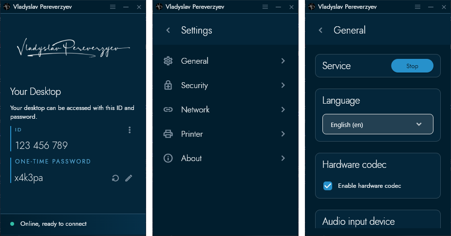
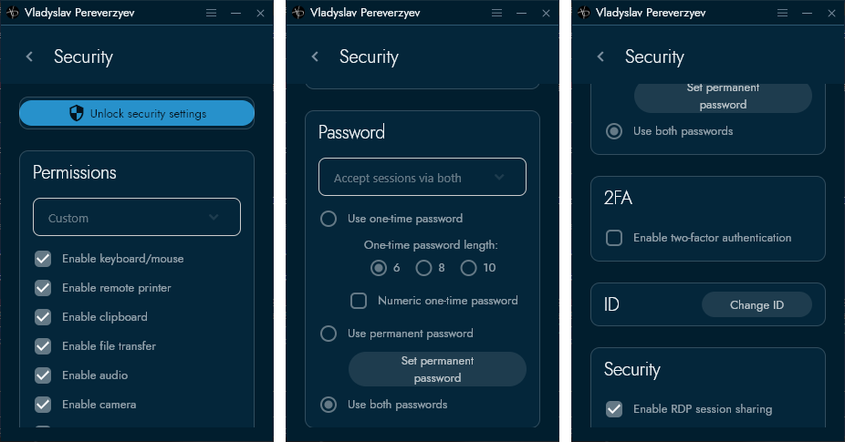
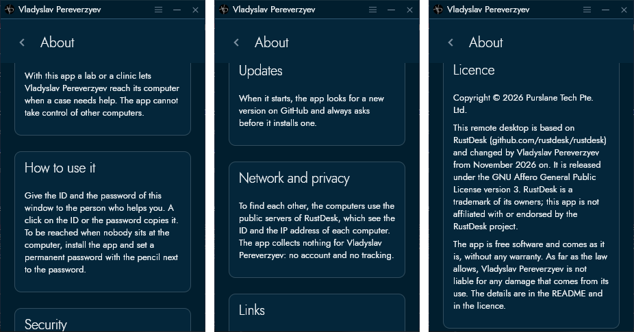

# Vladyslav Pereverzyev

[](https://github.com/vladpereverzyev/rustdesk/actions/workflows/build.yml)
[](https://github.com/vladpereverzyev/rustdesk/releases)
[](LICENCE)

[](https://github.com/vladpereverzyev/rustdesk/blob/vladpereverzyev/README.md)

Remote desktop for the labs and clinics that work with Vladyslav Pereverzyev, based on RustDesk.

The app is RustDesk with my name, the VP logo and the dark look of
[vladpereverzyev.com](https://vladpereverzyev.com). A lab or a clinic runs it when a case needs
help, so that I can reach their computer. It works on the same network as RustDesk, so I can
reach it from the original RustDesk too.

> [!CAUTION]
> Use the app only to reach a computer whose owner has agreed to it. Reaching a computer
> without permission, watching someone without their knowledge or taking their data is not
> allowed and is against the law in most countries. I am not responsible for any misuse of the
> app.

## Install

| Where | How |
| --- | --- |
| Windows 10 and 11, 64 bit | `VladyslavPereverzyev.exe` from the [latest release](https://github.com/vladpereverzyev/rustdesk/releases/latest) |

The download needs no installation: it runs as it is. It can be renamed, for example to
`Vladyslav Pereverzyev.exe`, so the icon on the Desktop shows the name.

## How to use it



- Open `VladyslavPereverzyev.exe`. The window shows the ID and a one-time password of this
  computer: give them to the person who helps you. One click on the ID or the password copies
  it.
- To reach a computer when nobody sits in front of it, install the app on it (the Install button
  at the bottom of the window, shown while the app runs from the download) and set a permanent
  password with the pencil next to the password.
- When somebody connects, a window of the same size shows their ID and what the session may do:
  keyboard and mouse, clipboard, sound, files and so on. Accept lets them in, Cancel sends them
  away. During the session the same window shows how long it has been running, a chat and the
  Disconnect button, which ends it at any moment.

The window always keeps the same small size. The menu button at the top opens the settings in
the same window, as a list of pages with a back arrow.



Once the app is installed, the Security and Network pages are locked, so that only somebody who
may change the computer can change them: the blue button at the top of the page asks Windows
for the permission first.

Allow a connection only to people you know. Somebody who has the ID and the password can see the
screen, use the mouse and open the files of that computer.

## Updates

The app updates itself from the [releases](https://github.com/vladpereverzyev/rustdesk/releases)
of this repository:

1. When it starts, the app asks GitHub for the latest release and compares its number with its
   own.
2. When a newer release is out, a window says so, with the new version number and two buttons:
   Later and Update.
3. Nothing is downloaded or installed until the user presses Update: there is no automatic
   update. The app then downloads the new `VladyslavPereverzyev.exe` with a progress bar, installs
   it over the old one once no session is open and starts again. Windows may ask for
   permission, as for the first installation.
4. When the app only runs from the downloaded exe, without being installed, the button is
   Download instead, which opens the release page.

Before it installs anything, the app checks the downloaded file: it must come over HTTPS from a
release of this repository and have the size and the SHA-256 checksum that GitHub shows for it.
If either does not match, the file is deleted and nothing is installed.

The app never updates to RustDesk or from the RustDesk servers. The updater of RustDesk only
accepts files signed with the RustDesk key, so the app uses its own source and keeps the rest of
the RustDesk updater: the download and the installation. The check can be turned off
in Settings, General, "Check for software update on startup". Builds that do not come from a
release tag never offer an update.

## Works with RustDesk

The app and RustDesk use the same network, so the app works with every RustDesk app:

| The other side runs | It can reach this app |
| --- | --- |
| RustDesk for Windows, macOS or Linux | yes |
| RustDesk for Android | yes |
| RustDesk for iPhone and iPad | yes |
| RustDesk in the browser ([web client](https://rustdesk.com/web/)) | yes |

The app only lets its computer be reached: it has no field to type the ID of another computer
and cannot take control of one. To help somebody, I use the RustDesk app.

A customer who already has RustDesk does not need to install anything else. I can also help a
customer from my phone with the RustDesk app.

Each program has its own ID. A computer with both RustDesk and this app installed has two IDs,
one for each program.

## Privacy

The app does not collect anything for me: there is no account, no tracking and no server of mine
in between. To find each other, the two computers use the public servers run by RustDesk, which
see the ID and the IP address of each computer. When the two computers cannot talk directly, the
session also passes through a RustDesk relay server. The screen, the keyboard, the clipboard and
the files of a session are encrypted end to end, so these servers cannot read them.

To look for updates, the app asks GitHub for the latest release when it starts, so GitHub sees
the IP address of the computer, as when you open a page of the site.

The computers of dental labs and clinics often hold patient data, which the GDPR treats as
health data. Before you let somebody in:

- Allow a session only when you need help and stay in front of the computer while it runs.
- Close the programs and the folders with patient data that the helper does not need to see.
- A business that reaches the computers of its customers, as I do, usually needs a written data
  processing agreement with each of them (Article 28 GDPR). Ask your privacy consultant.

This section explains how the app works. It is not legal advice.

The About page of the app says the same in short, with the version and the links to the source
code and the licence.



## What is in it

This branch keeps the RustDesk code as it is. My changes live in a few places:

- `res/vladpereverzyev/brand.py` patches the RustDesk code at build time: the name, the Windows
  file details, the dark theme in the colours of vladpereverzyev.com with the Jost font and the
  icons and logos made from the images in `res/vladpereverzyev/`.
- `res/vladpereverzyev/update.rs` is the source of the updates (see [Updates](#updates)). The
  script copies it into the code and points the RustDesk updater to it.
- `.github/workflows/build.yml` builds the Windows x64 exe on every push to this branch and
  publishes a release for every `v*` tag.

The technical name of the app is `vladpereverzyev`: Windows uses it for the exe, the service
and the install folder, because RustDesk allows only letters there. Everything people read, from
the window title and the shortcuts to the list of installed apps, says Vladyslav Pereverzyev.

The `master` branch follows [rustdesk/rustdesk](https://github.com/rustdesk/rustdesk). New
RustDesk versions are merged from `master` into `vladpereverzyev`.

The build leaves out the usbmmidd virtual display driver that RustDesk ships, because it is a
third-party binary without a clear license to pass it on. Without it the app cannot add a
virtual screen to a computer that has no monitor.

To build it yourself, follow the [RustDesk build guide](https://rustdesk.com/docs/en/dev/build/)
and run `python res/vladpereverzyev/brand.py` before the build (it needs `pip install pillow`).

## Code signing

The exe is built from this branch by the [Build & Release](.github/workflows/build.yml)
workflow on the servers of GitHub, so anybody can see how each download was made.

The exe has no code signing certificate yet. The first time Windows SmartScreen shows a blue
warning "Windows protected your PC": click "More info", then "Run anyway". Some antivirus
programs of companies block unsigned programs: in that case ask your IT to allow
`VladyslavPereverzyev.exe`.

To make sure the file is the one built here, compare its SHA-256 with the one GitHub shows next
to the file on the [release page](https://github.com/vladpereverzyev/rustdesk/releases/latest).
On Windows, open PowerShell in the folder of the download and run:

```powershell
Get-FileHash .\VladyslavPereverzyev.exe -Algorithm SHA256
```

## Warranty and liability

The app is free software and comes as it is, without any warranty, as sections 15 and 16 of the
[AGPL-3.0](LICENCE) say. As far as the law allows, I am not liable for any damage that comes from
using the app or from not being able to use it: for example lost or changed data, a computer
that stops working, a session that does not connect or the work lost while waiting.

Whoever runs the app on a computer decides who may reach it and is responsible for that computer
and its data, patient data included. Under the GDPR the lab or the clinic stays the data
controller of its own data. The RustDesk servers, GitHub and the networks in between are run by
others and I have no control over them.

The app is a tool for remote help. It is not a medical device and plays no part in the diagnosis
or the treatment of patients.

Nothing in this README limits the rights that the law of your country gives you and that cannot
be waived. When I help a customer for work, the written agreement between us applies.

## Contributing

This branch only holds my name, theme, updates and build on top of RustDesk. Please read
[CONTRIBUTING.md](CONTRIBUTING.md) and the [Code of Conduct](CODE_OF_CONDUCT.md) first. Bugs and
ideas for the remote desktop itself belong to
[RustDesk](https://github.com/rustdesk/rustdesk/issues). Security problems go to the
[security policy](SECURITY.md), not to a public issue.

## Support

Questions about the app: see [SUPPORT.md](SUPPORT.md) or write to info@vladpereverzyev.com.

If you want to support the remote desktop itself, support
[RustDesk](https://github.com/sponsors/rustdesk), the people who write it.

## License

Copyright (C) 2026 Vladyslav Pereverzyev for the changes in this branch. RustDesk is Copyright
(C) Purslane Tech Pte. Ltd. and the RustDesk contributors.

This app is a modified version of RustDesk, changed from November 2026 on, and is released under
the [GNU Affero General Public License v3.0](LICENCE). You can use, study, modify and share it for
free. If you distribute a modified version or offer it to users over a network you must publish
your source code under the same license. The source code of every build is this branch. Each
release on GitHub also comes with the source code of the tag it was built from.

The name "Vladyslav Pereverzyev", the VP logo and the Vladyslav Pereverzyev signature in
`res/vladpereverzyev/` are not covered by the AGPL-3.0 and may not be used for modified versions
without permission.

RustDesk is a trademark of its owners. This app is not affiliated with or endorsed by the
RustDesk project. Other product names and trademarks belong to their owners.

Third-party components keep their own licenses. See [NOTICE](NOTICE) and
[THIRD-PARTY-NOTICES.md](THIRD-PARTY-NOTICES.md).
